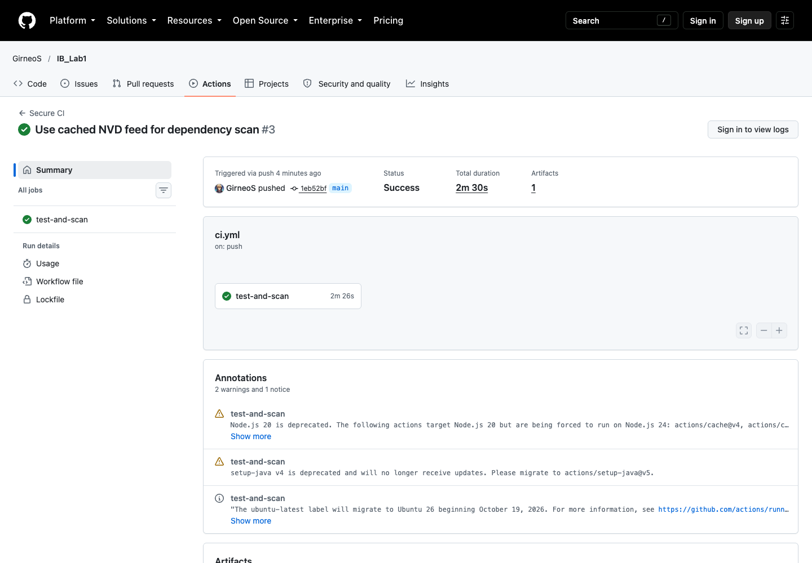
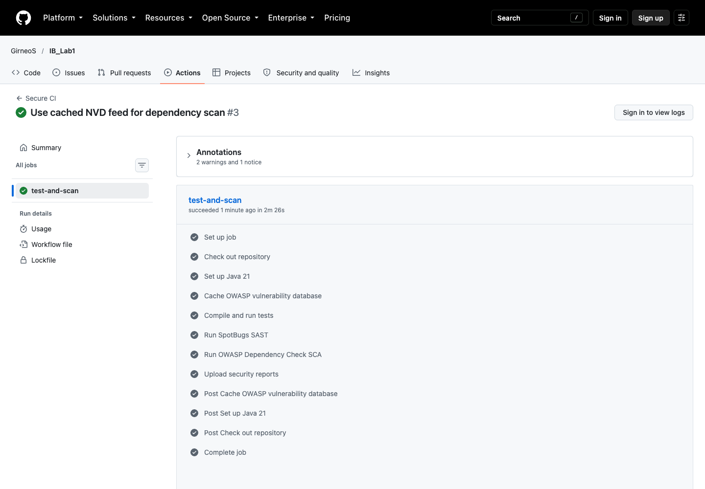

# Защищённый REST API

Лабораторная работа 1 по дисциплине «Информационная безопасность». Приложение реализовано на Java 21, Spring Boot 4.1.1 и SQLite. API выдаёт JWT после проверки логина и пароля, хранит заметки пользователя и запрещает доступ к данным без токена.

## Запуск

Требуется Java 21. Maven устанавливать не нужно: проект содержит Maven Wrapper.

```bash
export JWT_SECRET="$(openssl rand -base64 32)"
export APP_ADMIN_USERNAME="admin"
export APP_ADMIN_PASSWORD="replace-with-a-strong-password"
./mvnw spring-boot:run
```

Для локальной демонстрации без переменных окружения создаётся пользователь `admin` с паролем `ChangeMe123!`. Эти значения нельзя использовать вне учебного локального запуска. Файл SQLite `secure-api.db` создаётся автоматически и исключён из Git.

## Методы API

### POST /auth/login

Проверяет учётные данные и возвращает JWT со сроком действия 15 минут.

```bash
curl -sS -X POST http://localhost:8080/auth/login \
  -H 'Content-Type: application/json' \
  -d '{"username":"admin","password":"ChangeMe123!"}'
```

Пример ответа:

```json
{"access_token":"eyJ...","token_type":"Bearer","expires_in":900}
```

Сохранение токена для следующих запросов:

```bash
TOKEN=$(curl -sS -X POST http://localhost:8080/auth/login \
  -H 'Content-Type: application/json' \
  -d '{"username":"admin","password":"ChangeMe123!"}' \
  | python3 -c 'import json,sys; print(json.load(sys.stdin)["access_token"])')
```

### GET /api/data

Возвращает заметки текущего пользователя. Без корректного Bearer-токена сервер отвечает `401 Unauthorized`.

```bash
curl -sS http://localhost:8080/api/data -H "Authorization: Bearer $TOKEN"
```

### POST /api/data

Создаёт заметку для текущего пользователя. Это третий метод, выбранный для задания.

```bash
curl -sS -X POST http://localhost:8080/api/data \
  -H "Authorization: Bearer $TOKEN" \
  -H 'Content-Type: application/json' \
  -d '{"title":"Первая заметка","content":"Данные доступны только владельцу токена"}'
```

## Реализованные меры защиты

### Защита от SQL-инъекций

Все обращения к SQLite выполняются через `JdbcTemplate` и параметры `?`. Пользовательские значения передаются драйверу отдельно от SQL-текста. Конкатенация строк при построении запросов не применяется. Интеграционный тест отправляет в поле логина строку `admin' OR '1'='1` и проверяет, что аутентификация не выполняется.

### Защита от XSS

API принимает только JSON, проверяет длину обязательных полей и возвращает `Content-Type: application/json`. Заголовки ответа включают `X-Content-Type-Options: nosniff` и строгую Content Security Policy. Значения `title` и `content`, введённые пользователем, перед отправкой экранируются через `HtmlUtils.htmlEscape`. Тест подтверждает, что строка `<script>` не возвращается клиенту в исполняемом виде.

### Аутентификация и контроль доступа

Пароли сохраняются только как BCrypt-хэши с параметром стоимости 12. После успешного входа сервер подписывает JWT алгоритмом HMAC-SHA-256. Spring Security проверяет подпись, издателя и срок действия токена на каждом защищённом запросе. Сервер не создаёт HTTP-сессии. Запросы к `/api/data` без токена получают статус 401, а выборка заметок дополнительно ограничена именем пользователя из `sub` JWT.

Секрет подписи и начальные учётные данные читаются из переменных окружения. Файлы `.env` и базы данных исключены из репозитория.

## Тесты и проверки безопасности

```bash
./mvnw verify
./mvnw spotbugs:check
./mvnw dependency-check:check
```

GitHub Actions запускает эти команды при каждом push и pull request:

- тесты Spring Boot проверяют JWT, запрет анонимного доступа, попытку SQL-инъекции и XSS-экранирование;
- SpotBugs выполняет статический анализ кода (SAST);
- OWASP Dependency-Check проверяет зависимости по базе известных уязвимостей (SCA) и формирует HTML/JSON-отчёты;
- отчёты сохраняются в артефакте `security-reports` запуска workflow.

Первое выполнение Dependency-Check загружает поддерживаемое проектом OWASP зеркало данных NVD. GitHub Actions сохраняет локальную базу анализатора в кэше, поэтому следующие проверки выполняются быстрее.

Файл `dependency-check-suppressions.xml` содержит одно точечное подавление ложного совпадения: CVE-2025-15104 относится к Nu Html Checker (`nu.validator:validator`), но анализатор сопоставляет его с Hibernate Validator из-за общего CPE-имени `validator`. Подавление ограничено одновременно конкретным CVE и package URL Hibernate Validator.

## Структура проекта

```text
src/main/java/ru/itmo/secureapi
├── auth       — вход и выпуск JWT
├── common     — безопасные ответы об ошибках
├── config     — Spring Security и проверка JWT
├── note       — защищённые методы работы с заметками
└── user       — пользователи, BCrypt и доступ к SQLite
```

## CI/CD

Конфигурация находится в `.github/workflows/ci.yml`. Репозиторий и история запусков доступны по ссылкам:

- [публичный репозиторий](https://github.com/GirneoS/IB_Lab1);
- [GitHub Actions](https://github.com/GirneoS/IB_Lab1/actions);
- [успешный запуск с тестами, SAST и SCA](https://github.com/GirneoS/IB_Lab1/actions/runs/38528134407).

Успешный запуск workflow:



Выполненные шаги тестирования и анализа безопасности:


